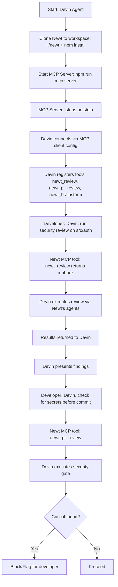
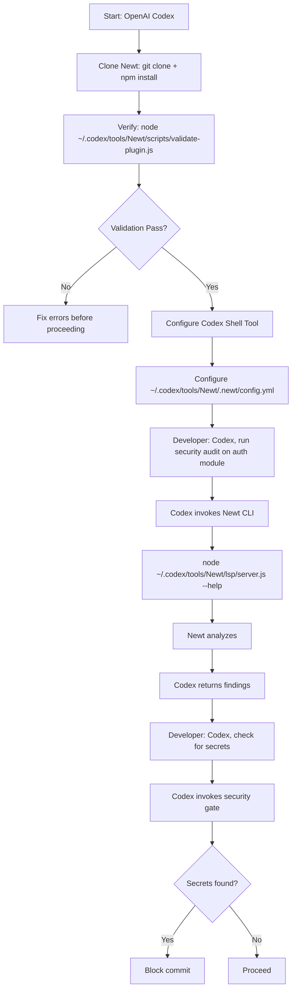
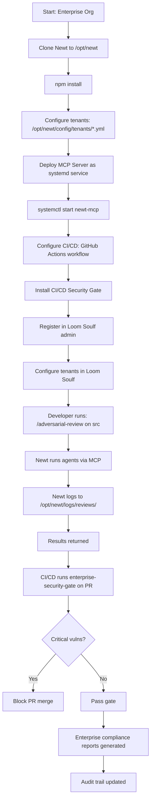
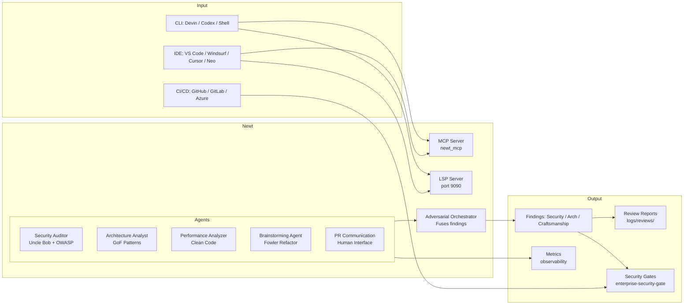
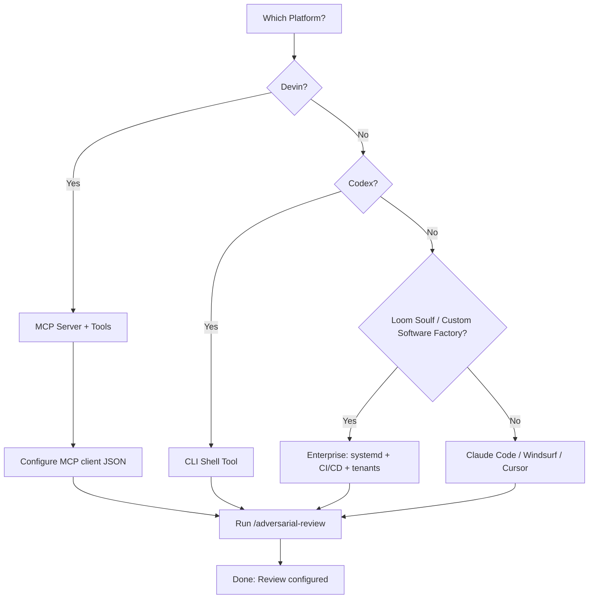

# Newt Installation Visualizations

## 1. Claude Code Installation Flow

```mermaid
flowchart TD
    A[Start: Developer] --> B[Clone Newt: git clone + npm install]
    B --> C[Open Claude Code Command Palette]
    C --> D{Is plugin available?}
    D -->|No| E[Run /plugin marketplace add ./Newt]
    E --> F[/plugin install newt]
    F --> G{Reload plugin?}
    G -->|Yes| H[Reload Window]
    G -->|No| I[Start using /review]
    H --> I

    I --> J[Run /adversarial-review]
    J --> K[Output: Summary + Issues + Security + Architecture + Craftsmanship]
```

---

## 2. Devin AI Installation Flow (MCP)



---

## 3. Codex Installation Flow (CLI)



---

## 4. Custom Software Factory / Loom Soulf Installation Flow (Enterprise)



---

## 5. Newt Agent Architecture (Visual)



---

## 6. Installation Decision Tree



---

## ASCII Art Summary

```
┌─────────────────────────────────────────────────────────────────────┐
│                    NEWT INSTALLATION PIPELINE                        │
├─────────────────────────────────────────────────────────────────────┤
│  PLATFORM         │  METHOD              │  TIME  │  KEY STEPS   │
├───────────────────┼─────────────────────┼────────┼─────────────┤
│ Claude Code       │ Marketplace Install │  2min  │ /review     │
│                   │                     │        │ /adversarial│
├───────────────────┼─────────────────────┼────────┼─────────────┤
│ Devin             │ MCP Server           │  3min  │ newt_review │
│                   │                     │        │ newt_pr    │
├───────────────────┼─────────────────────┼────────┼─────────────┤
│ Codex            │ CLI Shell           │  3min  │ npm run     │
│                   │                     │        │ validate    │
├───────────────────┼─────────────────────┼────────┼─────────────┤
│ Loom Soulf / CSF  │ Enterprise Service   │ 30min  │ systemd     │
│                   │                     │        │ + CI/CD     │
└─────────────────────────────────────────────────────────────────────┘
```

---

## Visual Installation Checklist

### For Claude Code / Windsurf / Cursor
```
[ ] git clone && npm install
[ ] /plugin marketplace add ./Newt
[ ] /plugin install newt
[ ] /review --path . --depth quick
[ ] /adversarial-review --path . --lens all
```

### For Devin
```
[ ] git clone && npm install
[ ] npm run mcp:server
[ ] Add MCP config to Devin client
[ ] Verify newt_review tool registered
[ ] Run security review
```

### For Codex
```
[ ] git clone && npm install
[ ] node scripts/validate-plugin.js (PASS)
[ ] Configure Codex shell tool
[ ] Run Newt CLI review
[ ] Run security gate
```

### For Enterprise (Loom Soulf)
```
[ ] Clone to /opt/newt
[ ] npm install
[ ] Configure tenants/*.yml
[ ] Deploy systemd service
[ ] Install CI/CD gate
[ ] Register in Loom Soulf
[ ] Run /adversarial-review
[ ] Run enterprise-security-gate
```

---

## Next Steps

- [Installation Index](index.md)
- [Adversarial Review Guide](../adversarial-review.md)
- [Enterprise Security Guide](../enterprise/security.md)
- [Enterprise Rollout Strategy](../enterprise/rollout.md)

---

## Visual Style Guide

These diagrams use Mermaid syntax for GitHub render support and ASCII art for terminal display. Both are intentionally simple — no complex graph state needed.

### Mermaid Support

All diagrams use standard Mermaid flowchart syntax (`flowchart TD`, `flowchart LR`). GitHub renders these natively in Markdown files.

### ASCII Fallback

For terminals or documentation without Mermaid rendering, the ASCII art at the bottom provides a quick summary.

---

## Appendix: Installation Time Estimates

| Platform | Steps | Time | Complexity |
|----------|-------|------|------------|
| Claude Code | 4 | 2 min | Low |
| Devin | 3 | 3 min | Medium |
| Codex | 3 | 3 min | Medium |
| Enterprise | 7 | 30 min | High |

---

## Visual Verification Checklist

Before marking an installation complete, verify:

```
[✓] Plugin/CLI validates without error
[✓] First review runs without error
[✓] Adversarial review runs (if enabled)
[✓] Security gate blocks critical issues (if enterprise)
[✓] Logs written to expected locations
```

---

## Related

- [Installation Guides](index.md)
- [Adversarial Review](../adversarial-review.md)
- [Enterprise Security](../enterprise/security.md)
- [API Reference](../api-reference.md)